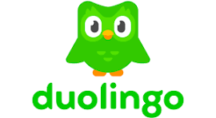
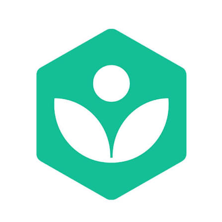
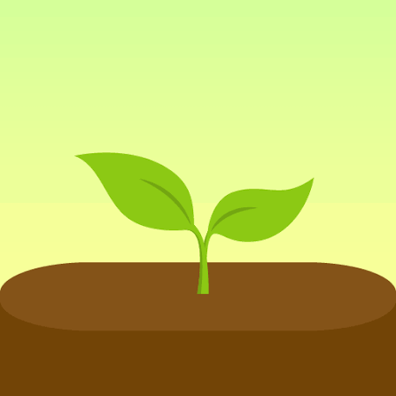
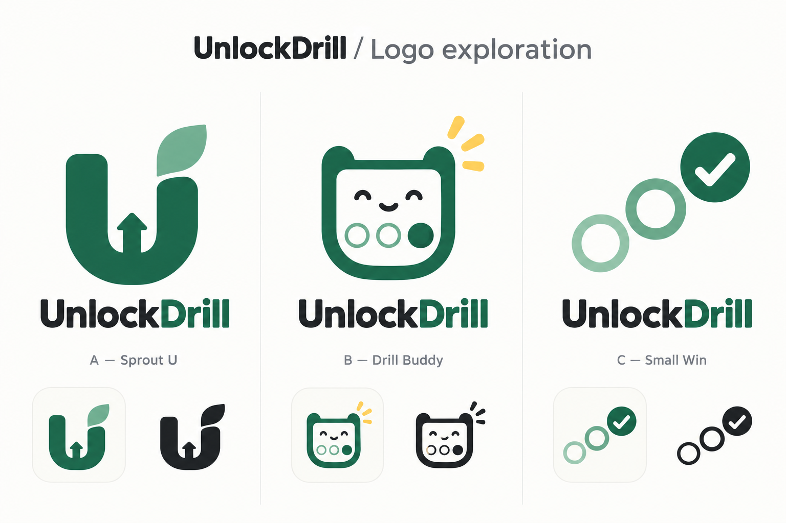
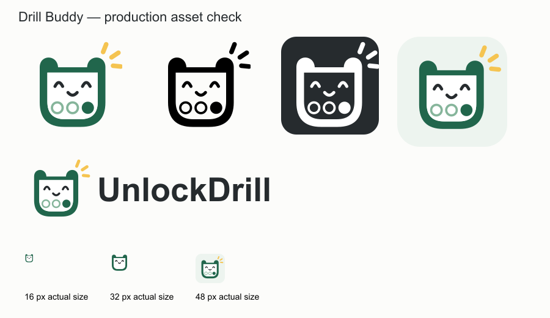

# Logo exploration — October 17

The team supplied the following reference images. These are user-provided images, not browser captures verified by the agent; the links identify the reference brands. They are inspiration references, not UnlockDrill artwork or endorsements.

| Reference | Uploaded image | Design observation |
| --- | --- | --- |
| [Duolingo](https://www.duolingo.com/) |  | Friendly character and simple green shapes. |
| [Khan Academy](https://www.khanacademy.org/) |  | Compact geometric learning/growth symbol. |
| [Forest](https://www.forestapp.cc/) |  | Growth metaphor and calm green palette. |

Observations above describe the images; they are not reconstructed team feedback.

## New concepts

AI-generated concept exploration: A — Sprout U; B — Drill Buddy; C — Small Win. These are raster concepts, not final vector masters or proof of 16 px legibility.

## Team decision

On October 17, the team selected the second concept, **B — Drill Buddy**, after viewing the sheet: “use second one.” This supersedes the earlier open-U direction as the selected direction for further production. The team has not yet supplied a reason for rejecting A or C. The earlier phone check applies to the old logo, not this newly selected concept.

## Production refinement and checks

The selected answer-card mascot was redrawn as editable SVG geometry for flat colors, reproducible variants, and small-size export. The [generated standalone preview](standalone-generated-preview.png) introduced a glow; it is exploration history, not production artwork. Production masters are in [logo/](../../logo/).

The assistant inspected this rendered sheet on October 17. At 16 and 32 px, the simplified favicon omits answer bubbles and rays to preserve the face and outline. Full-detail marks start at 48 px. This is a rendered desktop asset check, not a new physical-phone check.

Production decisions: retain the selected friendly answer-card face, forest/mint palette, and filled answer bubble; remove the generated glow and texture. These are implementation decisions following the team's choice of B, not fabricated historical team feedback. A and C remain unselected alternatives.
