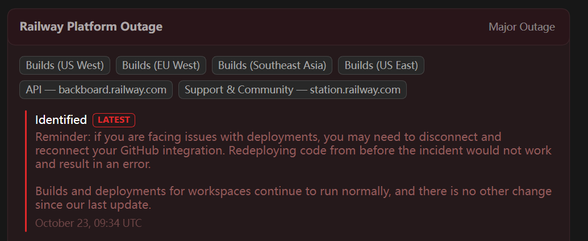

# HW 5 MVP Document and Pages

## Table of Contents

- [Overview](#overview)
- [Repository Directory](#repository-directory)
- [Homepage and Landing Pages](#homepage-and-landing-pages)
- [Deployment Status](#deployment-status)
- [Results](#results)

## Overview

This folder contains Aplovia's MVP product brief and the homepage and landing-page plan developed for HW 5. Aplovia is a bilingual college-planning product for international high-school students applying for first-year admission to U.S. undergraduate programs. The pages describe the broader product vision, distinguish it from the smaller working MVP, and test three research-backed value propositions: personal fit, financial feasibility, and trustworthy college information.

## Repository Directory

| File | Description |
|---|---|
| [MVP Product Brief](./mvp_doc.md) | Defines the current MVP, later product direction, cut and Wizard of Oz work, technical stack, success measure, risks, and named team responsibilities. |

## Homepage and Landing Pages

The public production URL is temporarily unavailable because the selected hosting provider, Railway, is experiencing a platform outage. The pages have been implemented and verified locally at the URLs below. After Railway service is restored, the same four routes will be deployed publicly and this README will be updated with the production domain.

| Page | Current verification URL | Audience | Value proposition |
|---|---|---|---|
| Homepage |  | International high-school students applying for first-year admission to U.S. undergraduate programs, especially students who lack experienced family or counselor support and do not know where to begin | Aplovia helps students find colleges that fit their preferences, financial situation, and academic background, then build a clearer and more trustworthy path from college research to application planning. |
| College Fit Landing Page |  | International students who rely on rankings because they are unsure what kind of college suits them or how to translate their priorities into a college search | Students can choose the location, campus setting, school type, and other factors that matter to them, apply those requirements consistently, and verify the details instead of receiving another generic ranking list. |
| Affordability Landing Page |  | International students and families who need to understand whether a college may be financially realistic before spending time and money on an application | Students can compare their family's maximum annual contribution with an official annual cost estimate and review international financial-aid policies separately, without treating aid as guaranteed. |
| Trust Landing Page |  | International students who find college information scattered across websites and third-party sources and are uncertain whether summaries are current, complete, or trustworthy | Aplovia organizes important college information while keeping the original source, data year, link, and last-checked date visible so students can verify consequential facts themselves. |

Each page includes a waitlist call to action. The homepage collects an email address, user identity, current college-process challenge, and optional interest in testing the prototype. Each focused landing page collects an email address and optional testing interest. The waitlist does not collect grades, test scores, family budget, or product preferences.

## Deployment Status

Deployment could not be completed on October 23, 2026 because Railway reported a **Major Outage** affecting builds and its API. The application and deployment configuration are ready, but attempting to present a failed or inaccessible deployment as a live product would be misleading.

*Railway status page captured on October 23, 2026, showing the platform outage that prevented deployment.*

## Results

The completed work translates the interview and synthesis findings into four testable demand pages. The homepage communicates Aplovia's complete product direction and the smaller feature set already implemented. The three landing pages each isolate one student problem and value proposition, use research language and current product screenshots, and invite visitors to join the waitlist or volunteer for prototype testing.
