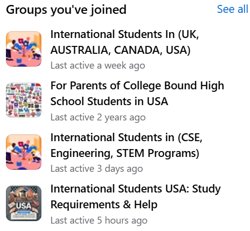

# Demand Strategy - Team AIDI

## Traffic Ownership

Jonah Smith will be responsible for traffic each week with no rotations to other team members.

## Top Communities

Our top communities include Facebook, which will have about 500+ views per post.

## Social Posting Schedule

Every Saturday of every week, by 6pm, we will have a personal Facebook post, infographic Instagram post, and a YouTube Short uploaded of pieces of our demo. We will change this and increase this consistent amount of posting as needed. This is our rough draft.

So far, we have one post: [Facebook post](https://www.facebook.com/share/p/19Xf73cs8F/).

## Blog Posting Schedule

Saturday at 6pm, weekly.

- Saturday 10/24 - 5 reasons applying to college is hard for international students
- Saturday 10/31 - What I learned from interviewing 10 international students
- Saturday 11/7 - How we're fixing finding your U.S. college
- Saturday 11/14 - 5 reasons international students struggle to find their U.S. colleges
- Saturday 11/21 - What I learned from 10 college interviews with international students
- Saturday 11/28 - How we're finding the best U.S. college tuition for you
- Saturday 12/5 - A guide for finding the best U.S. college for you
- Saturday 12/12 - A guide for finding accurate information about U.S. colleges
- Saturday 12/19 - 5 reasons Chinese international students struggle with applications

## Email Strategy

For our email strategy we will weekly, on Saturday at 6pm, send out information about new features as development and feedback continues. We don't know when features will be released exactly, so as a plan b, we can do a sort of newsletter with fluff pointing to our blog.
