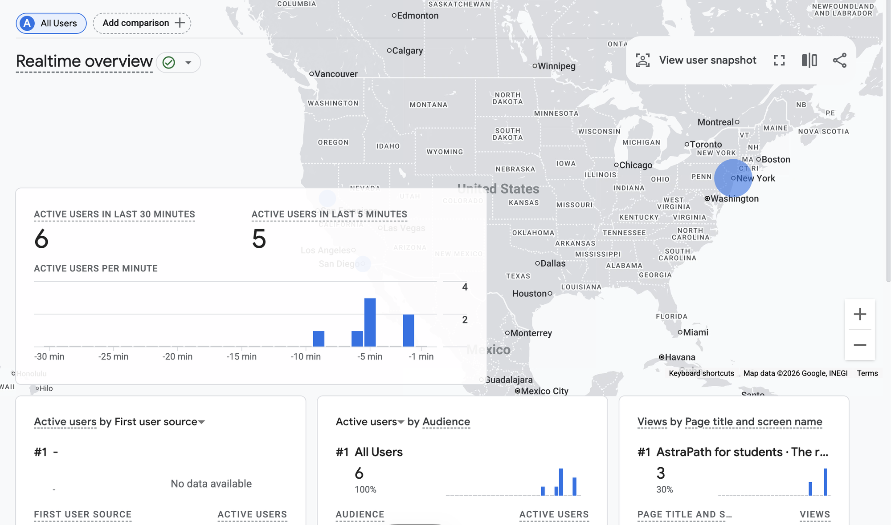
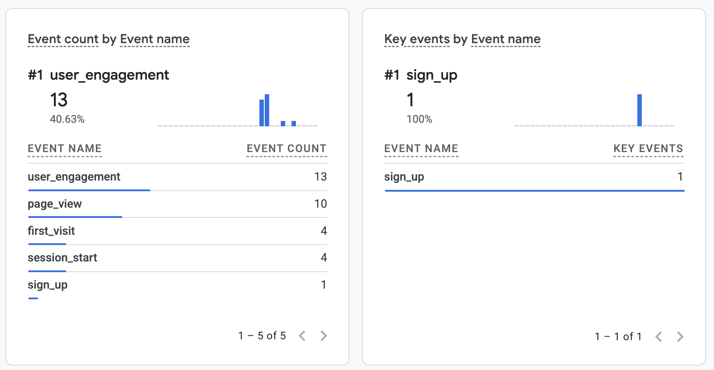

# HW6: Demand plan and analytics

**Team Pola (AstraPath), 2026-11-11.**

## Part 1: Demand strategy

See [demand_strategy.md](demand_strategy.md). It covers traffic owners by week, communities, the social and blog schedules, the email plan, and the math for reaching 100 signups by Demo Day.

## Part 2: Analytics on every page

- **Property:** Google Analytics 4 property "AstraPath" (New York time, US dollars), with a Web data stream for `https://astrapath-indoornav.netlify.app`. The measurement ID is `G-T6NKRMZNNS`.
- **Tag:** the Google tag is in the `<head>` of every page:
  - [Homepage](https://astrapath-indoornav.netlify.app/)
  - [Students](https://astrapath-indoornav.netlify.app/students/)
  - [Visitors](https://astrapath-indoornav.netlify.app/visitors/)
  - [Step-free](https://astrapath-indoornav.netlify.app/step-free/)
  - [Venues](https://astrapath-indoornav.netlify.app/venues/)
  - [Thank-you page](https://astrapath-indoornav.netlify.app/thanks/)
- **Signup event:** after someone joins the waitlist, they land on the thank-you page. It fires a `sign_up` event, with `signup_page` set to the page they signed up on. `sign_up` is marked as a key event in Google Analytics.
- **UTMs:** every link we post uses lowercase UTMs. The convention is in [demand_strategy.md](demand_strategy.md#social-posting-schedule). Each waitlist signup also saves its UTMs in Netlify Forms, so we can count signups by post even where Google Analytics doesn't load.
- **Realtime check:** two screenshots, taken after the tag went live:
  - [ga-realtime.png](ga-realtime.png): active users and page views
  - [ga-realtime-sign-up.png](ga-realtime-sign-up.png): `page_view` and `sign_up` in the event count, and `sign_up` counted as a key event

